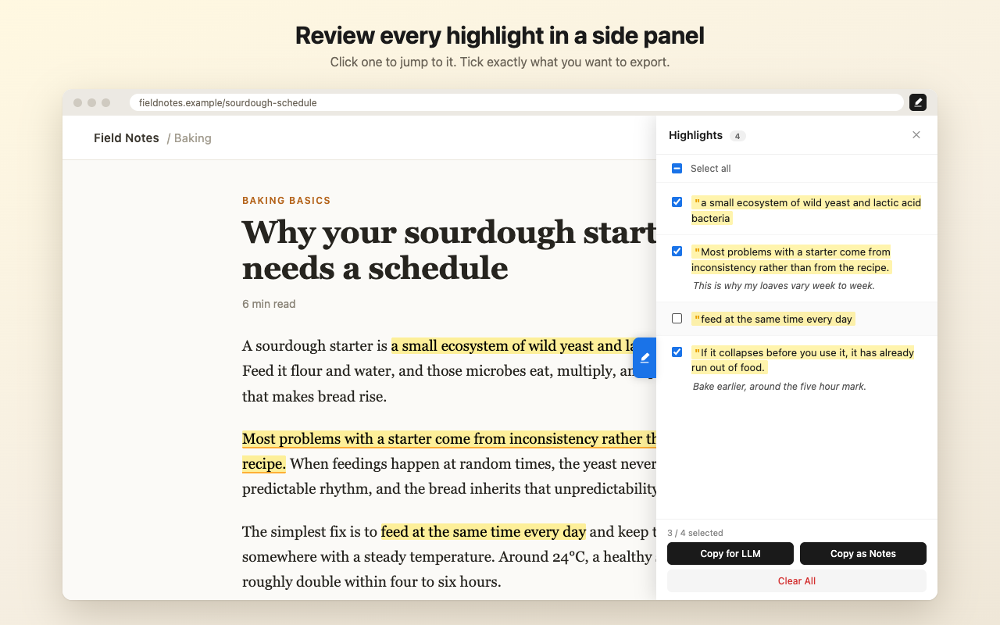

# Web Annotator

Highlight text on any webpage, add notes, and copy them out as markdown for an AI assistant or your notes app. Everything stays in your browser.



**[Install from the Chrome Web Store](https://chromewebstore.google.com/detail/web-annotator/bljcagphmcdbadlihboooencnfhinood)** — the recommended way. It updates automatically.

## Features

- Highlight text on any webpage with one click
- Add notes to your highlights
- Review all highlights for a page in a side panel, and jump to any of them
- Pick exactly which highlights to export
- **Copy for LLM**: markdown with your quotes, your notes clearly labelled, and the source link, in the order they appear in the article
- **Copy as Notes**: a bullet list that pastes cleanly into Obsidian, Notion, or Apple Notes
- Highlights come back automatically when you revisit a page
- Turn the extension off for any site

## Privacy

- All highlights and notes are stored locally in your browser (`chrome.storage.local`)
- The extension makes no network requests. Nothing is uploaded, and there are no analytics, tracking, or accounts
- The side panel and note editor run in an isolated part of the page, so the website you are on cannot read your notes, either the ones you have saved or what you type while writing one

### What it does not protect

- **The website can see what you highlighted.** Highlights are drawn on the page itself, so the site can tell which passages you marked and whether a highlight has a note. It cannot read the note text. It can also tell that the extension is installed
- **Your notes are not encrypted.** Anyone who can use your computer or your Chrome profile can read them
- **There is no backup or sync.** Uninstalling the extension or clearing browser data deletes your highlights and notes, and they cannot be recovered
- **Copied quotes can include hidden text.** If a page hides text inside a passage you highlight, that text is copied too. Read what you paste before sending it to an AI
- **Some pages are off-limits.** Chrome does not let extensions run on its own pages, the Chrome Web Store, or the built-in PDF viewer

### Fixed in 1.0.3

In 1.0.2 and earlier, a website could read a note while you were typing it on that website's page (not notes you had already saved, and not notes written on other sites). 1.0.3 blocks this. Chrome updates the extension automatically.

Full policy: [privacy-policy.html](https://kermityen.github.io/web-annotator/privacy-policy.html)

## Install from GitHub (manual)

For trying a release before it reaches the store, or for running without the store.

1. Go to [Releases](https://github.com/kermityen/web-annotator/releases/latest) and download the `web-annotator-<version>.zip` file
2. Unzip it into a folder you will keep. If you delete the folder later, the extension stops working
3. Open `chrome://extensions` in Chrome
4. Turn on **Developer mode** (top right)
5. Click **Load unpacked** and choose the unzipped folder

To update, download the new release, replace the folder's contents, and click the reload icon on the extension's card in `chrome://extensions`.

> [!IMPORTANT]
> A copy installed from GitHub and the Chrome Web Store version are two separate extensions to Chrome, and they do not share data. If you later switch to the store version, highlights made in the GitHub copy will not come with you. There is no export feature yet.

## How to use

- Select text, then click **Highlight** or **Note**
- Click a highlight to remove it or edit its note
- Press Cmd+Enter (Mac) or Ctrl+Enter (Windows, Linux) to save a note
- Click the tab on the right edge of the page to open the side panel

Data lives in your browser, so clearing browser data also deletes your notes.

## Permissions

| Permission | Why |
|---|---|
| `storage` | Saves highlights and notes locally |
| `activeTab`, `tabs` | Lets the popup read the current tab's address and title, to show that page's highlights |
| All websites | Lets you highlight on any page, and restores your highlights when you come back |

## Known limitations

- On some sites built with React, highlighting can make part of the page misbehave until you reload it
- If the same text appears more than once on a page, a restored highlight may land on a different copy of it
- Copied links drop known tracking and login parameters (such as `utm_*` or `access_token`), but an unusually named private parameter could still slip through

## Development

Load the repo folder itself with **Load unpacked** to run from source.

Unit tests for the copy formats:

```bash
node tests/unit/export-format.test.mjs
```

The browser test suite drives the real extension in Chrome for Testing:

```bash
node tests/browser/harness.mjs <unpacked-extension-folder>
```

Set `CHROME=/path/to/chrome-for-testing` if it is not in Playwright's default cache.

## License

[GPL v3](LICENSE)
